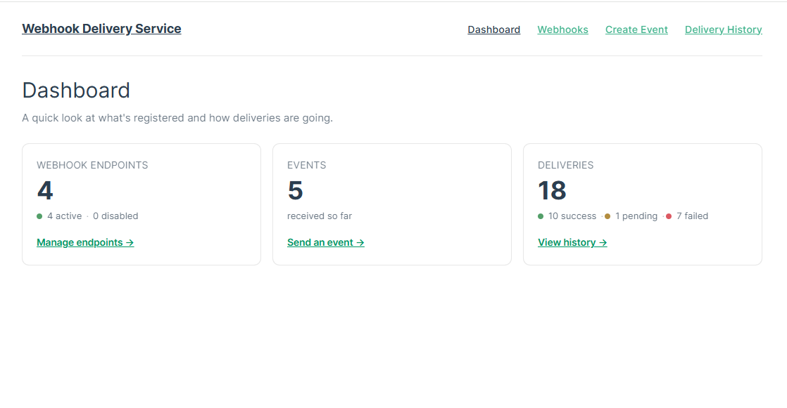
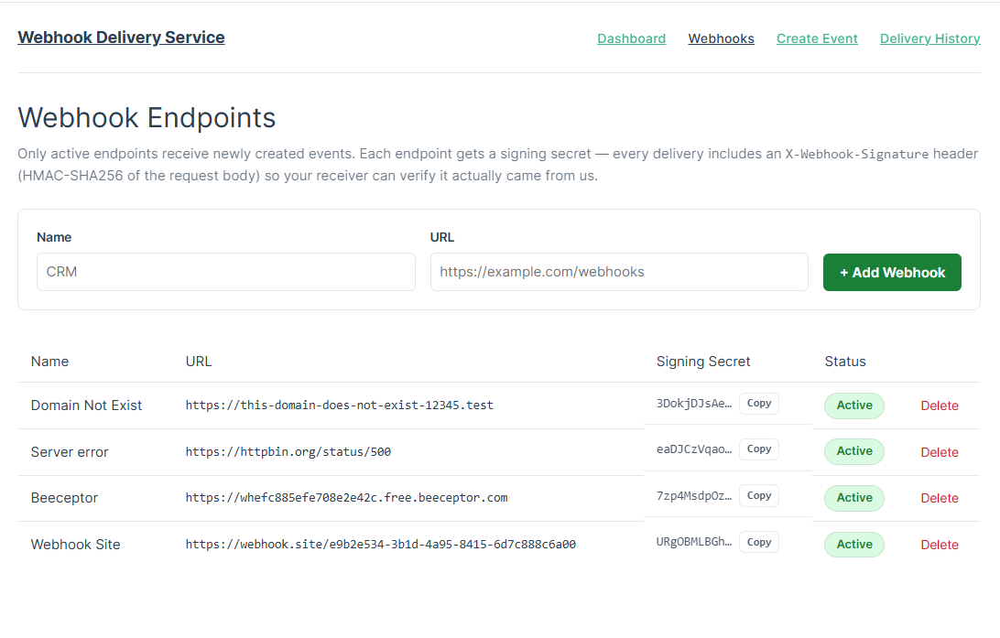

# Webhook Delivery Service

A small service that receives events and delivers them to registered webhook endpoints,
keeping a full history of what was sent and what happened.

```
Receive Event → Process Event → Deliver Webhook → Track Result
```

## Demo

[](https://drive.google.com/file/d/1emEpFytMEZ61wGMeXjatuqiFvLYf39dr/view?usp=drive_link)

*Click the screenshot above to watch a short walkthrough of the app (backend API, frontend,
and delivery/retry flow in action).*

## Table of Contents

1. [Project Overview](#1-project-overview)
2. [Installation](#2-installation)
3. [Usage](#3-usage)
4. [Architecture](#4-architecture)
5. [Technical Decisions](#5-technical-decisions)
6. [Edge Cases & Limitations](#6-edge-cases--limitations)
7. [Testing](#7-testing)
8. [AI Tools](#8-ai-tools)

## 1. Project Overview

This is a two-part app:

- **Backend** — a Laravel 13 (PHP 8.4) JSON API. It lets you register webhook endpoints,
  accepts events, and delivers each event to every active endpoint.
- **Frontend** — a small Vue 3 app with four screens: a dashboard, webhook management,
  event creation, and delivery history.

Here's the flow in plain terms: you send an event to the API. The API saves it, then hands
off one delivery job per active webhook endpoint to a background queue. Each job makes the
actual HTTP call, waits for a response, and writes down what happened — success, failure,
how many times it was tried, and why it failed if it did.

The important part is that step happens **in the background**. Creating an event returns
instantly, even if one of your webhook endpoints is slow or completely offline. A dead
endpoint can't block, slow down, or break delivery to the other endpoints.

A few things this app does that go a bit beyond the bare minimum, because they're the kind
of thing a real webhook platform needs:

- Every delivery is **signed** with an HMAC signature, so a receiving server can verify it
  genuinely came from us.
- Failed deliveries **retry automatically** a few times, and can also be **retried manually**
  later from the UI or API.
- It runs the same way with or without Docker — one command either way.

## 2. Installation

You can run this with Docker (fastest, nothing to install) or natively (if you already have
PHP/Node set up). Both work equally well — pick whichever is more convenient.

### Option A — Docker

All you need is Docker Desktop (or Docker Engine + Compose).

```bash
docker compose up --build
```

That's it. This one command:

1. Builds the backend (PHP 8.4) and frontend (Node 22) images.
2. Runs the database migrations once, automatically.
3. Starts the API server, the background queue worker, and the frontend dev server.

Once it's running:

| | |
|---|---|
| Frontend | http://localhost:5173 |
| API | http://localhost:8000/api |

You don't need to touch a `.env` file or generate an app key yourself — every container does
that on its own the first time it starts.

The database (SQLite) lives in a Docker volume, so your data survives a restart
(`docker compose down` then `up` again). If you want a totally clean slate — say, after
changing a migration — wipe it with:

```bash
docker compose down -v
```

A few handy commands once it's up:

```bash
docker compose exec app php artisan test        # run the backend test suite
docker compose exec app php artisan db:seed     # load sample data (see Usage below)
docker compose logs -f queue                    # watch deliveries happen live
```

> **Port already taken?** If 8000 or 5173 is busy on your machine, just change the left side
> of that service's `ports:` line in `docker-compose.yml`.

### Option B — Native (no Docker)

**You'll need:**

- PHP 8.2 or newer (built and tested on 8.4)
- Composer
- Node.js 20+
- Nothing else — SQLite ships with PHP's `pdo_sqlite` extension, no separate database
  server to install

**Backend:**

```bash
composer install
cp .env.example .env
php artisan key:generate
touch database/database.sqlite      # on Windows: New-Item database/database.sqlite
php artisan migrate

php artisan serve                   # → http://localhost:8000
php artisan queue:work              # run this in a second terminal — it delivers webhooks
```

That second command matters — without a queue worker running, events get created but never
actually delivered. They'll just sit as `pending`.

If you use [Laravel Herd](https://herd.laravel.com), the backend is served automatically once
the folder is picked up — you still need `queue:work` running for deliveries to happen.

**Frontend:**

```bash
cd frontend
cp .env.example .env    # points the app at your API URL
npm install
npm run dev              # → http://localhost:5173
```

> If `npm install` complains about a peer dependency conflict between `oxlint` and
> `eslint-plugin-oxlint`, that's an unrelated version mismatch in the dev tooling — just run
> `npm install --legacy-peer-deps` instead.

## 3. Usage

### Try it in two minutes

Once the app is running (either option above), the fastest way to see it work:

1. Open the frontend and go to **Webhooks**. Add an endpoint — for a URL you can actually
   watch requests hit, use one of the free tools below.
2. Go to **Create Event**, leave the sample payload as-is, and hit **Send Event**.
3. Go to **Delivery History**. You'll see a `pending` row — once the queue worker (or Docker's
   `queue` container) picks it up, it flips to `success` or `failed`.

Prefer sample data instead of doing this by hand? Run:

```bash
php artisan migrate:fresh --seed                        # native
docker compose exec app php artisan db:seed              # Docker
```

This fills the database with a handful of endpoints, ~20 events, and a realistic mix of
successful, pending, and failed deliveries — written directly, not by making real HTTP calls,
so it's instant.

### Free tools for testing webhook delivery

You don't need a real server to try this out — these are free and let you watch deliveries
arrive in real time:

- **[webhook.site](https://webhook.site)** — gives you a unique URL instantly (no signup),
  shows every incoming request live, including headers like our `X-Webhook-Signature`, and
  the exact JSON body we sent.
- **[Beeceptor](https://beeceptor.com)** — similar idea, but also lets you set up a custom
  mock response (status code, body, delay), which is handy for deliberately testing failure
  and timeout handling from the receiving end.
- **`https://httpbin.org/status/{code}`** — no signup, no UI, just returns whatever HTTP
  status code you ask for. The quickest way to trigger a specific failure (e.g. `/status/500`)
  without setting anything up.

### Screenshots

**Dashboard** — a quick summary of endpoints, events, and delivery outcomes.


**Webhooks** — register endpoints, toggle them active/inactive, and grab each one's signing
secret.



**Create Event** — send an event with a custom payload straight from the browser.


**Delivery History** — every attempt, its status, HTTP result, and how many times it was
tried — with a retry button on anything that failed.


### Using the API directly

Everything below works with plain `curl`. There's no authentication on the API itself (see
[Technical Decisions](#5-technical-decisions) for why), so you can try these right away.

**Register a webhook endpoint**

```bash
curl -X POST http://localhost:8000/api/webhooks \
  -H "Content-Type: application/json" -H "Accept: application/json" \
  -d '{"name": "CRM", "url": "https://crm.example.com/webhooks"}'
```

The response includes a `secret` — a signing key generated just for this endpoint (more on
that below).

**Enable/disable or remove an endpoint**

```bash
curl -X PATCH http://localhost:8000/api/webhooks/1 \
  -H "Content-Type: application/json" -H "Accept: application/json" \
  -d '{"is_active": false}'

curl -X DELETE http://localhost:8000/api/webhooks/1 -H "Accept: application/json"
```

**Send an event**

```bash
curl -X POST http://localhost:8000/api/events \
  -H "Content-Type: application/json" -H "Accept: application/json" \
  -d '{
        "event_type": "user.created",
        "data": {"id": 123, "name": "John Doe", "email": "john@example.com"}
      }'
```

`event_id` is optional — leave it out and the server generates one for you. The response
tells you how many deliveries were queued:

```json
{
  "data": {
    "id": 1,
    "event_id": "evt_01JABC123",
    "event_type": "user.created",
    "payload": { "id": 123, "name": "John Doe", "email": "john@example.com" },
    "deliveries_count": 2,
    "created_at": "2026-08-21T10:31:00.000000Z"
  }
}
```

**View delivery history**

```bash
curl "http://localhost:8000/api/deliveries?status=failed"
curl "http://localhost:8000/api/deliveries/1"
```

**Retry a failed delivery**

```bash
curl -X POST http://localhost:8000/api/deliveries/1/retry -H "Accept: application/json"
```

This only works on deliveries that are currently `failed` — you'll get a `422` if you try it
on something still `pending` or already `success`. See [Technical
Decisions](#5-technical-decisions) for why.

**Check overall stats**

```bash
curl "http://localhost:8000/api/stats"
```

Returns endpoint/event/delivery counts — this is what powers the dashboard.

### How signature verification works

Every webhook request we send out carries this header:

```
X-Webhook-Signature: sha256=<HMAC-SHA256 of the raw request body, keyed with the endpoint's secret>
```

If you're building the receiving side, verify it like this (PHP example, but the idea is the
same in any language):

```php
$expected = 'sha256=' . hash_hmac('sha256', $rawRequestBody, $endpointSecret);
hash_equals($expected, $request->header('X-Webhook-Signature'));
```

If it matches, you know the request really came from this service and the body wasn't
altered in transit.

## 4. Architecture

```
 ┌────────────┐          ┌──────────────────────────┐
 │  Vue SPA   │──HTTP───▶│       Laravel API        │
 │ (frontend) │◀─────────│    routes/api.php        │
 └────────────┘          └────────────┬─────────────┘
                                       │
                     ┌─────────────────┼─────────────────┐
                     ▼                 ▼                 ▼
            WebhookEndpointCtrl  EventController   DeliveryController
                     │                 │                 │
                     ▼                 ▼                 ▼
              WebhookEndpoint     EventService      Delivery (read)
                   model               │
                                       ▼
                           creates Event + one Delivery
                           per active WebhookEndpoint,
                           dispatches DeliverWebhookJob
                                       │
                                       ▼
                           ┌────────────────────────┐
                           │   Queue (DB driver)     │
                           └────────────┬────────────┘
                                        ▼
                           ┌────────────────────────┐
                           │   DeliverWebhookJob     │
                           │   → WebhookDeliveryService
                           │   → Laravel HTTP client │
                           └────────────┬────────────┘
                                        ▼
                          updates the Delivery record
                          (status / http_status / attempt_count / last_error)
```

### The pieces, and what each one is responsible for

- **Controllers** (`app/Http/Controllers/Api`) — deliberately thin. They validate the
  request, call a service, and shape the response. No business logic lives here.
- **Services** (`app/Services`) — where the actual logic lives.
  - `EventService` creates events idempotently and fans them out to active endpoints.
  - `WebhookDeliveryService` handles a single delivery attempt: makes the HTTP call, signs
    it, and records the result.
- **Jobs** (`app/Jobs/DeliverWebhookJob.php`) — the queued unit of work for one delivery.
  This is what actually runs in the background.
- **Models** — `WebhookEndpoint`, `Event`, `Delivery`. Plain Eloquent models with the
  relationships between them.

### Database design

Three tables, kept intentionally simple:

| Table | What it stores |
|---|---|
| `webhook_endpoints` | `name`, `url`, `secret` (for signing), `is_active` |
| `events` | `event_id` (unique), `event_type`, `payload` (JSON) |
| `deliveries` | one row per `(event, webhook_endpoint)` pair — `status`, `http_status`, `attempt_count`, `last_error`, `delivered_at` |

The one rule enforced at the database level: a `(event_id, webhook_endpoint_id)` pair can
only appear once in `deliveries`. That's what guarantees an event never gets delivered twice
to the same endpoint, no matter what the application code does.

## 5. Technical Decisions

This section explains the *why* behind the choices above — not just what was built, but the
reasoning.

**Why background jobs instead of delivering synchronously?**
Because an event-creation request shouldn't have to wait on someone else's server. If a
webhook endpoint is slow or hanging, that's their problem, not something that should make
`POST /api/events` time out for the caller. Delivery happens in `DeliverWebhookJob`, run by
`php artisan queue:work` against Laravel's database queue driver. Database queue (not Redis)
was chosen on purpose — it means no extra infrastructure to install, just what already ships
with Laravel + SQLite.

**Why one delivery row per (event, endpoint) pair?**
So "did event X reach endpoint Y" is always a single, clear answer with its own retry
history — instead of something you have to reconstruct from logs. It also means one broken
endpoint never affects delivery to the others.

**How duplicate events are handled.**
`events.event_id` is unique in the database. When a new event comes in,
`EventService::createEvent()` checks for an existing row with that `event_id` first. If one
exists, it's returned as-is and **no new deliveries are created**. In practice, this means
you can safely retry a `POST /api/events` call (say, after a network blip on your end)
without worrying about double-firing webhooks.

**How retries work.**
Each delivery gets up to `Delivery::MAX_ATTEMPTS` (3) attempts. After a failed attempt, the
delivery stays `pending` as long as attempts remain — think of `pending` as "still in play,"
not just "hasn't been tried yet." It only becomes `failed` once all 3 attempts are used up.
Between attempts there's a short escalating delay (10 seconds, then 30). This is deliberate:
non-2xx responses, timeouts, and connection errors are *expected* outcomes of calling
someone else's server — not bugs — so they're handled as normal control flow inside
`WebhookDeliveryService`, not as exceptions bubbling up somewhere else.

On top of that automatic retry, there's a separate **manual retry**
(`POST /api/deliveries/{id}/retry`) for after the automatic budget runs out — say, once
you've fixed a typo in the endpoint URL. It's restricted to deliveries currently `failed`:
retrying a `pending` one would race the job that's already about to run it, and retrying a
`success` one serves no purpose. A manual retry runs through the exact same code path as an
automatic one, so there's only one delivery mechanism to reason about, not two.

**Why a 5-second timeout.**
So one unresponsive endpoint can't tie up a queue worker forever. Five seconds is generous
enough for a normal server, short enough that a hung connection doesn't stall everything
behind it.

**Only active endpoints get new events.**
`EventService` filters to `WebhookEndpoint::where('is_active', true)` at the moment an event
is created. Disabling an endpoint doesn't touch its existing delivery history — it just stops
it from receiving *future* events, which is how a "pause this integration" toggle should
behave.

**No API authentication, but every outgoing webhook is signed.**
The assessment explicitly leaves authentication out of scope, so the API itself is
intentionally open — in a real deployment, the write endpoints would sit behind an API key
or a Sanctum token. But signing outgoing webhooks felt worth doing anyway, because it's the
half of "authentication" that matters most for a webhook system specifically: it lets whoever
receives our webhooks confirm the request really came from us, not an authentication gate on
our own API.

**Why Laravel API + separate Vue app, instead of Blade.**
The brief specifically offered this as an option, and a decoupled frontend/API is a more
realistic shape for a "delivery service" — something other systems might also want to talk
to someday. CORS is left at Laravel's default (`*` on `/api/*`), which is fine for a local
project like this but would be locked down to a specific origin in a real deployment.

## 6. Edge Cases & Limitations

### What's handled

- **The same event submitted twice** → the second submission is a no-op. Same event
  returned, no new deliveries.
- **A disabled endpoint** → skipped when fanning out new events.
- **Non-2xx response, connection failure, DNS failure, timeout** → all caught and recorded
  with a readable error message, then retried up to the attempt limit.
- **Invalid webhook URL or malformed event data** → rejected with a `422` and field-level
  errors before anything touches the database.
- **Deleting an endpoint that has delivery history** → its deliveries are deleted along with
  it (cascade). Reasonable for this project's scope; a real production system would probably
  soft-delete endpoints instead so history survives.
- **A delivery that's permanently failed** → filterable in the delivery list
  (`?status=failed`), and can be manually retried without touching the database directly.
- **Whether a webhook request can be trusted** → every request is HMAC-signed, so it isn't
  just "whatever hit your endpoint."

### What's intentionally left out (and why that's OK for this scope)

- **No auth on the API itself.** Signing covers "did this webhook really come from us," but
  not "who's allowed to call this API." Out of scope per the brief.
- **Fixed retry delays (10s, then 30s)**, not a fully configurable backoff strategy.
- **Simple page-number pagination** (25 per page), not cursor-based — plenty for the amount
  of data this project generates.
- **No schema validation per event type.** The `payload` field accepts any JSON object; the
  app doesn't check that a `user.created` event looks a particular way.
- **Docker is built for "clone it and run it," not live development.** Code is baked into the
  image at build time rather than mounted from your machine, so a code change needs
  `docker compose up --build` to take effect. For active development, use the native setup
  (Option B) or Herd instead.

## 7. Testing

### Backend

```bash
php artisan test
```

96 tests, run with Pest. Roughly, they cover:

- **Webhook endpoints** — creating, listing, enabling/disabling, deleting, and validation
  errors along the way.
- **Events** — creation, duplicate `event_id` handling, and making sure only active
  endpoints receive new deliveries. These use `Http::fake()`, so nothing actually hits the
  network.
- **Delivery logic** (`WebhookDeliveryService`) — a successful (2xx) response, a non-2xx
  failure, a connection-level failure, a delivery reaching `failed` once attempts run out,
  and that the signature header is computed correctly.
- **The delivery job** (`DeliverWebhookJob`) — retrying up to the max attempt count,
  stopping early after a later success, and not blowing up if the delivery record no longer
  exists.
- **Delivery listing, filtering, and manual retry** — including that retry correctly
  refuses anything that isn't currently `failed`.
- **The stats endpoint.**

Tests run against an in-memory SQLite database with the queue set to run synchronously (see
`phpunit.xml`), so a dispatched job runs immediately, inline, in the same test — no separate
worker process needed to see the result.

### Frontend

```bash
cd frontend
npm run test:unit
```

This covers the API client (`src/api/client.js`) — the one piece of frontend code with real
logic worth testing on its own: parsing a successful response, turning a `422` into a proper
error with its field messages attached, treating "204 No Content" correctly instead of trying
to parse an empty body, and not sending empty filters in the query string.

Given the time budget, testing effort went mostly into the backend, where the actual
business logic (retries, idempotency, signing, failure handling) lives. The Vue views
themselves are thin wrappers around the API and were checked by hand in the browser rather
than with component tests.


## 8. AI Tools

### Where AI tools were particularly useful

AI tools are part of my everyday workflow now — the pace this industry expects makes that
less of a luxury and more of a baseline skill. For this project, Claude Code was useful in
two ways at once.

First, as a learning accelerator: it let me pick up patterns and approaches faster than
researching alone would have, especially for parts of the stack I touch less often. Second,
as an implementation partner: things that used to take a lot of trial and error — wiring up
a queue-based retry flow, structuring the API cleanly, getting Docker Compose right on the
first real run — came together noticeably faster, because I could iterate on a working
version instead of building everything from a blank file.

In practice, that meant learning and building happened at the same time, instead of one
blocking the other.
